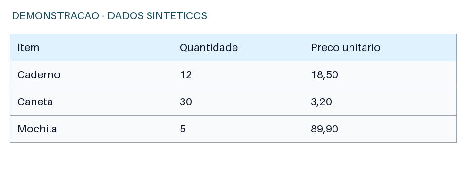

# Table Extractor

Converta **imagens de tabelas em JSON, CSV e Excel**, usando um modelo de visão e
validações locais. Funciona com imagens fornecidas pelo usuário, sem depender de
site específico, banco de dados ou serviços de armazenamento.



## O que faz

- Identifica cabeçalhos e linhas da tabela principal em PNG, JPEG ou WebP.
- Solicita saída estruturada com JSON Schema e verifica o contrato localmente.
- Preserva texto, sinais, zeros à esquerda e separadores decimais.
- Marca células vazias, cabeçalhos duplicados e linhas incompletas para revisão.
- Aceita regras opcionais para colunas, número mínimo de linhas, chaves únicas e intervalos numéricos.
- Exporta arquivos locais com status, avisos, hash da imagem normalizada, modelo, uso de tokens e tempo da chamada.
- Oferece CLI, interface Streamlit e uma demonstração offline com dados sintéticos.

## Começar pela demonstração

Requisitos: Python 3.10+ e pip. Execute os comandos dentro desta pasta.

```bash
python -m venv .venv
```

Ative o ambiente no PowerShell com `.\.venv\Scripts\Activate.ps1` ou, no
Linux/macOS, com `source .venv/bin/activate`. Depois:

```bash
python -m pip install -e ".[dev,ui]"
table-extractor --demo --profile examples/validation-profile.json
```

O comando cria uma pasta de execução dentro de `outputs/`, contendo `sample.png`,
`result.json`, `table.csv` e `table.xlsx`. **A demo usa uma resposta predefinida:
não faz OCR, não chama um modelo e não mede a precisão da IA.**

Também é possível usar `python -m table_extractor` no lugar de `table-extractor`.
Para instalar somente a CLI, use `python -m pip install -e .`.

## Extrair sua própria imagem

Copie `.env.example` para `.env` e configure sua chave. No PowerShell:

```powershell
Copy-Item .env.example .env
```

No Linux/macOS: `cp .env.example .env`.

```dotenv
OPENAI_API_KEY=sua_chave_local
OPENAI_MODEL=gpt-4.1-mini
OPENAI_TIMEOUT=120
```

O modelo configurado deve aceitar imagens e saída estruturada com JSON Schema.
O nome padrão é configurável; sua disponibilidade depende da conta do provedor.
Variáveis já definidas no ambiente têm prioridade sobre `.env`.

```bash
table-extractor --image caminho/para/tabela.png
table-extractor --image examples/sample.png --profile examples/validation-profile.json
table-extractor --image caminho/para/tabela.jpg --output outputs/minhas-tabelas
```

A extração real envia a imagem normalizada à API da OpenAI e pode gerar cobrança.
Nenhum banco ou conta AWS é necessário. A chave não é salva nos resultados.
O cliente envia `store=false`; isso não representa uma garantia de retenção zero
por parte do provedor. Use imagens que você possa compartilhar com o serviço.

### Conexão e certificados

As conexões HTTPS usam os certificados confiáveis do sistema operacional, por meio
de `truststore`, com verificação TLS ativa. Isso também permite usar certificados
de redes corporativas já instalados no Windows, sem modificar o SSL global do Python.
Se a rede exigir uma cadeia PEM específica, configure `REQUESTS_CA_BUNDLE` no `.env`.
Se precisar de proxy, configure `HTTPS_PROXY`. Não publique esses arquivos locais.
As mensagens distinguem falhas de certificado, proxy, conexão e tempo de resposta.
`OPENAI_TIMEOUT` controla a espera pela resposta; aumentar esse valor não corrige
uma falha de certificado.

## Interface visual

```bash
python -m streamlit run app.py
```

Escolha a demonstração ou envie uma imagem, execute a extração, compare a tabela
com a imagem e baixe os resultados. A chave pode ser informada na sessão ou
configurada no ambiente. A interface não persiste uploads em disco nem usa cache
compartilhado de resultados. Para hospedar publicamente, cada pessoa pode usar
sua própria chave na sessão; não exponha uma chave compartilhada sem controle de uso.

## Regras de validação opcionais

Sem perfil, o programa aceita cabeçalhos e quantidades de linhas variáveis.
Para um documento recorrente, use um JSON como
[`examples/validation-profile.json`](examples/validation-profile.json):

```json
{
  "expected_columns": ["Item", "Quantidade", "Preco unitario"],
  "min_rows": 3,
  "unique_columns": ["Item"],
  "numeric_columns": {
    "Quantidade": {"decimal_separator": ".", "min": 0},
    "Preco unitario": {"decimal_separator": ",", "min": 0, "max": 10000}
  }
}
```

Todas as propriedades são opcionais. `expected_columns` exige correspondência
exata, inclusive ordem e grafia. `unique_columns` define uma chave composta: a
combinação dos valores não pode se repetir. Os números são conferidos com
`Decimal`, mas as células exportadas continuam como texto. Nas colunas numéricas,
remova da imagem símbolos monetários e separadores de milhar, ou não aplique essa
regra: o validador aceita apenas sinal, dígitos e o separador decimal configurado.
Ele não adivinha unidades, moedas ou percentuais.

## Interpretar os resultados

- `validated`: passou nas verificações configuradas; **não garante transcrição correta**.
- `needs_review`: há avisos do modelo ou falhas de consistência; os arquivos são preservados para inspeção.
- Erro: entrada inválida, falha de rede ou resposta fora do contrato; não há resultado de extração exportado.

Códigos de saída da CLI: `0` para validação aprovada, `2` para revisão necessária
e `1` para erro. Cada execução usa uma pasta nova, sem substituir resultados anteriores.

O JSON preserva as células originais e os metadados. O Excel grava células como
texto literal. No CSV, conteúdos que poderiam virar fórmulas recebem um apóstrofo
inicial por segurança ao abrir em planilhas; use o JSON para fidelidade literal.
Células `null` ficam vazias no CSV/Excel e continuam identificáveis no JSON.

## Arquitetura

```text
Imagem local ou upload
        ↓
Validação e normalização da imagem (Pillow)
        ↓
Modelo de visão → JSON Schema
        ↓
Contrato + verificações determinísticas + perfil opcional
        ↓
JSON / CSV / Excel + status e avisos
```

```text
src/table_extractor/
  core.py        Contrato, perfis e validação sem rede
  provider.py    Normalização e integração com o modelo
  transport.py   HTTPS com certificados do sistema e suporte a proxy
  exporters.py   Arquivos locais e proteção contra fórmulas
  cli.py         Interface de linha de comando
  demo.py        Imagem e resposta sintéticas
app.py           Interface visual opcional
examples/        Amostra e perfil de validação
tests/           Testes com respostas simuladas, sem serviços externos
```

Não há scraping de sites, CAPTCHA, credenciais de infraestrutura, IDs de negócio
ou fontes comerciais fixas. Esta versão é uma implementação independente de uso geral.

## Desenvolvimento e testes

```bash
python -m pip install -e ".[dev]"
python -m pytest -q
python -m ruff check .
```

O workflow do GitHub executa verificações e demonstração offline em Linux com
Python 3.10, 3.12 e 3.13. Os testes não precisam de chave, rede, banco ou AWS.

## Limitações e avaliação

- Uma tabela principal por imagem. Tabelas adicionais podem ser omitidas.
- Sem suporte direto a PDF, documentos multipágina ou imagens animadas.
- Limites locais: 15 MiB de arquivo e 20 megapixels; a imagem normalizada também precisa caber em 15 MiB.
- Tabelas muito grandes podem exceder o limite de resposta; recorte em partes.
- Células mescladas, texto pequeno e layouts complexos podem causar erros.
- Não há repetição automática de chamadas: uma nova tentativa pode gerar nova cobrança.
- Os testes verificam o software com respostas simuladas. **Não há benchmark de precisão publicado.**

Para medir a qualidade, reúna imagens que possa redistribuir, transcreva as células
manualmente e compare acerto por célula, tabelas totalmente corretas e erros não
sinalizados. Registre também modelo, uso de tokens e latência. A imagem sintética
incluída é um exemplo funcional, não uma avaliação representativa.

## Licença

MIT. Os exemplos são sintéticos e não representam preços, estoques ou empresas reais.
